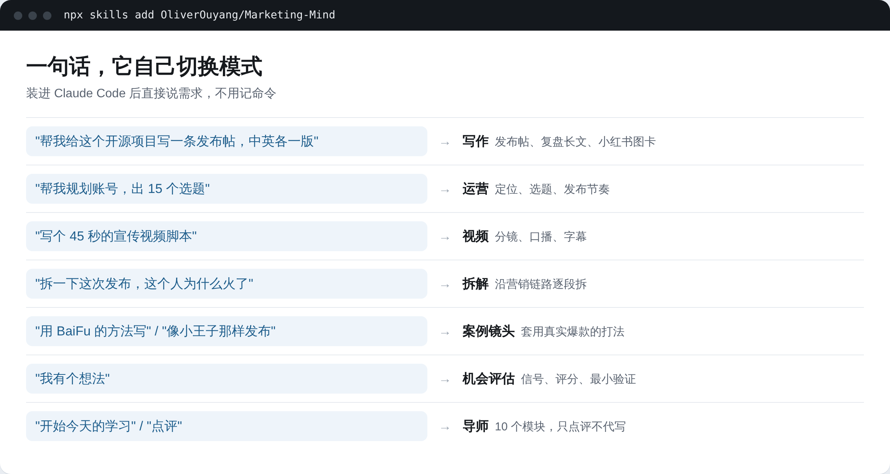
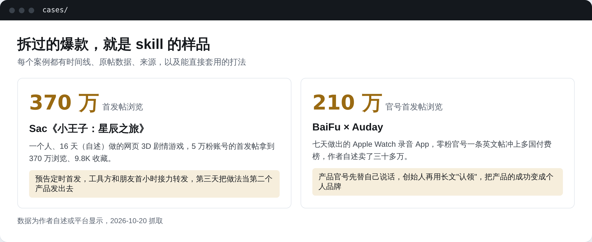
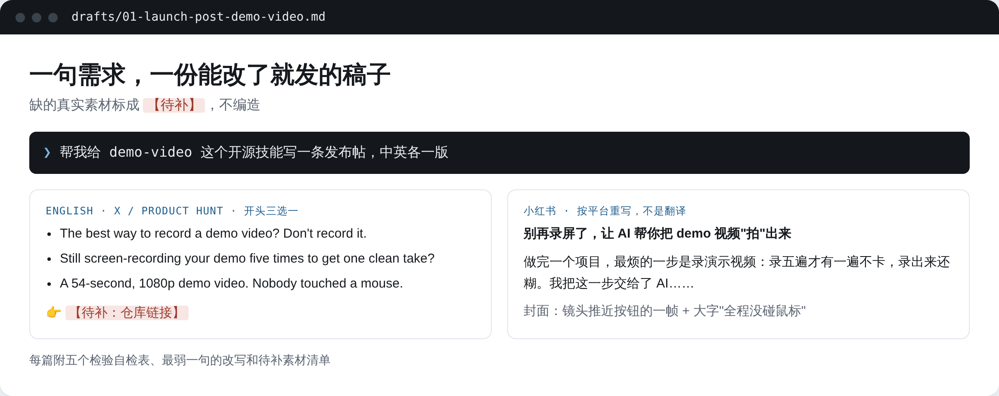
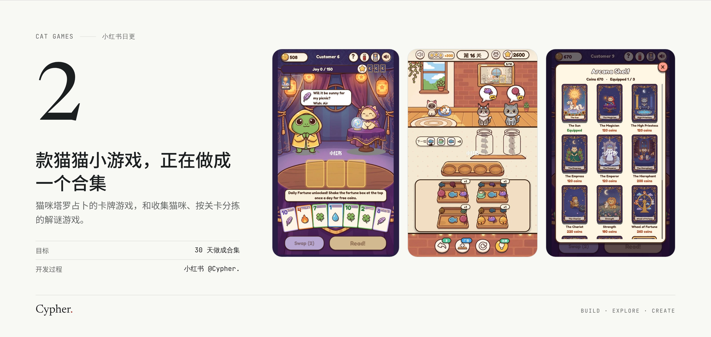
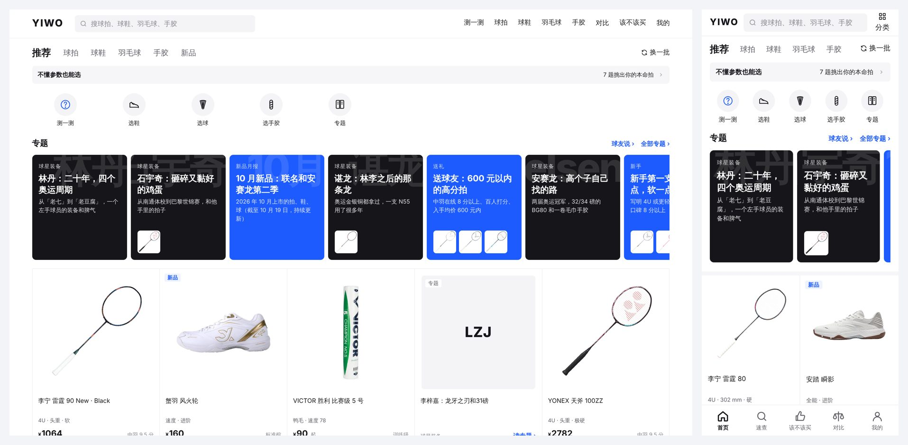

# 你好，我是 Oliver · Cypher.

> Decoding how good work gets seen.

UC Berkeley 在读。我做猫猫小游戏、羽毛球选拍网站和 AI 工作流，也经营一家宠物用品独立站。做出来的东西一直很难让人看到，所以我开始把营销当成一门课来系统地学，并且把学的过程全部公开。

## 正在做

### Marketing-Mind · 营销思维 Skill

把营销书、爆款拆解和练习装进你的 Claude Code：一个 skill 帮你写发布帖、复盘长文、小红书图卡和视频脚本，也能当导师带你练。10 个模块、70 多份带出处的精读笔记。

```bash
npx skills add OliverOuyang/Marketing-Mind
```

<p align="center"></p>

<p align="center"></p>

<p align="center"></p>

👉 [去仓库看看](https://github.com/OliverOuyang/Marketing-Mind)

### 猫猫小游戏合集

目标是一个月做成一个合集，正在小红书日更开发过程（[第 2 天的笔记](https://www.xiaohongshu.com/discovery/item/6acda7c00000000018015125)）。现在有两款：猫咪塔罗占卜的卡牌游戏，和收集猫咪、按关卡分拣的解谜游戏。

<p align="center"></p>

### 一握 YIWO

羽毛球选拍、选鞋、选球指南，7 道题测出适合你的球拍，看参数、价格和球友口碑。[yiwo.oouyang.com](https://yiwo.oouyang.com)

<p align="center"></p>

### 其他

| 项目 | 是什么 |
|---|---|
| [research-crawler](https://github.com/OliverOuyang/research-crawler) | 市场调研数据采集的方法和实测：Reddit、Google Trends、TikTok 怎么抓，平台怎么选，花多少钱 |
| [PawPlay](https://www.shoppawplay.com) | 我经营的宠物用品独立站 |

## 我在研究

- 独立作品的分发：为什么有的作品一夜几百万浏览，有的没人看
- AI Agent 工作流：用 Claude Code 做调研、写作、做视频
- 爆款拆解：BaiFu（MiroFish）、Sac（小王子 3D 游戏）的发布打法

## 找到我

- 小红书：[Cypher.](https://www.xiaohongshu.com/user/profile/647307c6000000001100214d)
- X：[@cypher_dot](https://x.com/cypher_dot)
